# Entity-Relationship (ER) Diagram & Relational Data Model

## Student Academic Progression and Portfolio Management System
**Department of Computer Engineering &middot; DBMS Mini-Project**

---

### 1. Visual ER Diagram (Mermaid)

```mermaid
erDiagram
    STUDENTS ||--o{ SEMESTERS : "has progression (1:N)"
    STUDENTS ||--o{ ACTIVITIES : "earns portfolio (1:N)"
    STUDENTS ||--o{ SEMINARS : "presents / participates (1:N)"
    STUDENTS ||--o{ GAP_YEARS : "records drop years (1:N)"
    SEMESTERS ||--o{ SEMESTER_SUBJECT_MARKS : "contains marks (1:N)"
    SUBJECTS ||--o{ SEMESTER_SUBJECT_MARKS : "graded in (1:N)"
    ACTIVITY_CATEGORIES ||--o{ ACTIVITIES : "classifies (1:N)"

    STUDENTS {
        int id PK "AUTOINCREMENT"
        string roll_no UK "UNIQUE, NOT NULL"
        string full_name "NOT NULL"
        string email UK "UNIQUE, NULLABLE"
        string phone "NULLABLE"
        string department "NOT NULL, DEFAULT 'Computer Engineering'"
        int admission_year "NOT NULL"
        real secondary_percent "CHECK(0.0 <= x <= 100.0)"
        real higher_secondary_percent "CHECK(0.0 <= x <= 100.0)"
        int current_semester "CHECK(1 <= x <= 12)"
        string current_status "CHECK(Active, Graduated, On Leave, Drop Year, Discontinued)"
        text created_at "CURRENT_TIMESTAMP"
    }

    SEMESTERS {
        int id PK "AUTOINCREMENT"
        int student_id FK "REFERENCES students(id) ON DELETE CASCADE"
        int semester_no "CHECK(1 <= x <= 12)"
        string academic_year "NOT NULL (e.g. '2023-2024')"
        real sgpa "CHECK(0.0 <= x <= 10.0)"
        real cgpa "CHECK(0.0 <= x <= 10.0)"
        string status "CHECK(Completed, Ongoing, Detained, Dropped)"
        text remarks "NULLABLE"
    }

    SUBJECTS {
        int id PK "AUTOINCREMENT"
        string subject_code UK "UNIQUE, NOT NULL (e.g. 'CS101')"
        string subject_name "NOT NULL"
        string subject_type "CHECK(Theory, Lab)"
        int credits "NOT NULL, DEFAULT 3"
        real default_max_marks "NOT NULL, DEFAULT 100.0"
    }

    SEMESTER_SUBJECT_MARKS {
        int id PK "AUTOINCREMENT"
        int semester_id FK "REFERENCES semesters(id) ON DELETE CASCADE"
        int subject_id FK "REFERENCES subjects(id) ON DELETE CASCADE"
        real marks_obtained "CHECK(x >= 0.0)"
        real max_marks "CHECK(max > 0 AND obt <= max)"
        real grade_point "CHECK(0.0 <= x <= 10.0)"
    }

    ACTIVITY_CATEGORIES {
        int id PK "AUTOINCREMENT"
        string name UK "UNIQUE, NOT NULL"
        string activity_type "CHECK(Technical, Co-curricular, Extra-curricular)"
    }

    ACTIVITIES {
        int id PK "AUTOINCREMENT"
        int student_id FK "REFERENCES students(id) ON DELETE CASCADE"
        int category_id FK "REFERENCES activity_categories(id) ON DELETE RESTRICT"
        string activity_name "NOT NULL"
        text description "NULLABLE"
        string activity_date "NOT NULL (YYYY-MM-DD)"
        string achievement_level "CHECK(Participant, Winner, Runner-up, College Level, State Level, National Level, International Level, Special Mention)"
        string certificate_ref "NULLABLE"
    }

    SEMINARS {
        int id PK "AUTOINCREMENT"
        int student_id FK "REFERENCES students(id) ON DELETE CASCADE"
        string title "NOT NULL"
        string seminar_type "CHECK(Internal, External)"
        string seminar_date "NOT NULL (YYYY-MM-DD)"
        string organizer "NOT NULL"
        string certificate_url "NULLABLE"
    }

    GAP_YEARS {
        int id PK "AUTOINCREMENT"
        int student_id FK "REFERENCES students(id) ON DELETE CASCADE"
        int start_year "NOT NULL"
        int end_year "NOT NULL, CHECK(end_year >= start_year)"
        string gap_type "CHECK(Academic Drop, Medical Leave, Financial / Personal, Preparation / Transition)"
        text reason "NOT NULL"
    }

    SYNC_LOG {
        int id PK "AUTOINCREMENT"
        text synced_at "NOT NULL"
        string sync_type "NOT NULL, DEFAULT 'Manual'"
        string status "CHECK(SUCCESS, FAILED, PARTIAL)"
        int records_synced "NOT NULL, DEFAULT 0"
        text message "NULLABLE"
    }
```

---

### 2. Relational Schema & Cardinality Details

| Relationship | Cardinality | Parent Entity | Child Entity | Foreign Key Action |
| :--- | :--- | :--- | :--- | :--- |
| **Student to Semesters** | $1 : N$ | `students(id)` | `semesters(student_id)` | `ON DELETE CASCADE` |
| **Semester to Marks** | $1 : N$ | `semesters(id)` | `semester_subject_marks(semester_id)` | `ON DELETE CASCADE` |
| **Subject to Marks** | $1 : N$ | `subjects(id)` | `semester_subject_marks(subject_id)` | `ON DELETE CASCADE` |
| **Category to Activities** | $1 : N$ | `activity_categories(id)` | `activities(category_id)` | `ON DELETE RESTRICT` |
| **Student to Activities** | $1 : N$ | `students(id)` | `activities(student_id)` | `ON DELETE CASCADE` |
| **Student to Seminars** | $1 : N$ | `students(id)` | `seminars(student_id)` | `ON DELETE CASCADE` |
| **Student to Gap Years** | $1 : N$ | `students(id)` | `gap_years(student_id)` | `ON DELETE CASCADE` |

---

### 3. Normalization Defense (1NF, 2NF, 3NF)

- **1NF (First Normal Form):** Every column stores atomic (indivisible) scalar values. No repeating multi-valued strings (such as a comma-separated list of subjects or marks in a single row). Each table has an explicit Primary Key.
- **2NF (Second Normal Form):** All tables are in 1NF and every non-key attribute is fully functionally dependent on the entire Primary Key. In the composite join table `semester_subject_marks`, `marks_obtained` and `grade_point` depend strictly on the combination of `(semester_id, subject_id)`, and subject metadata (`subject_name`, `subject_type`, `credits`) is properly factored out into the `subjects` master table.
- **3NF (Third Normal Form):** All tables are in 2NF and there are no transitive functional dependencies ($X \rightarrow Y$ where $Y \rightarrow Z$). Student profile details (name, department, 10th %, 12th %) are stored once in `students`; semester performance attributes (SGPA, CGPA) are stored in `semesters`; and activity category classifications are normalized into `activity_categories` rather than repeating string labels across activity rows.
